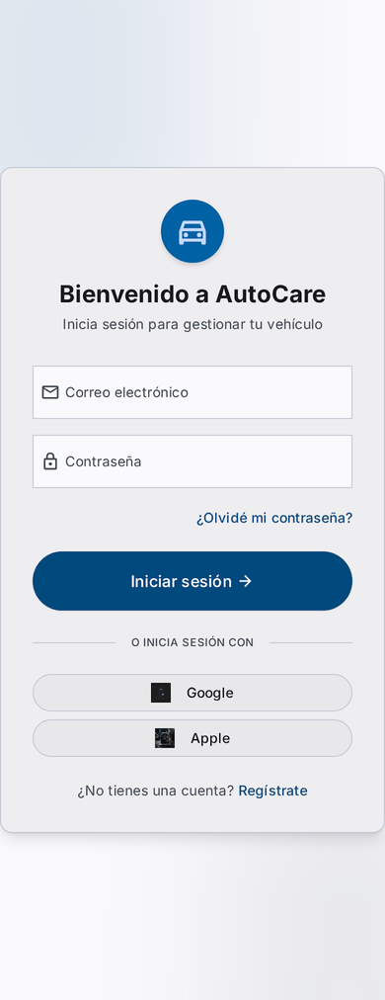
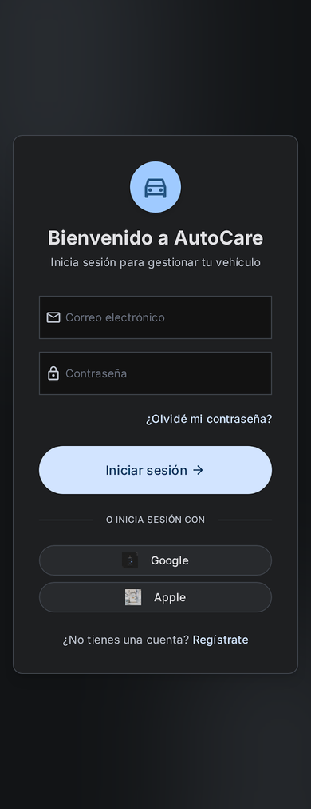
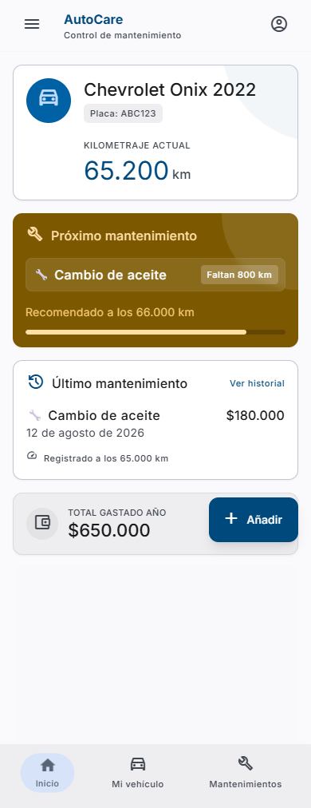
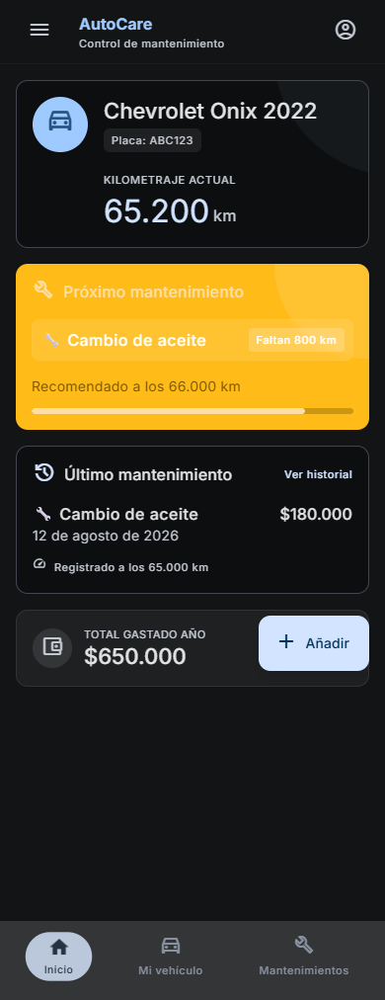
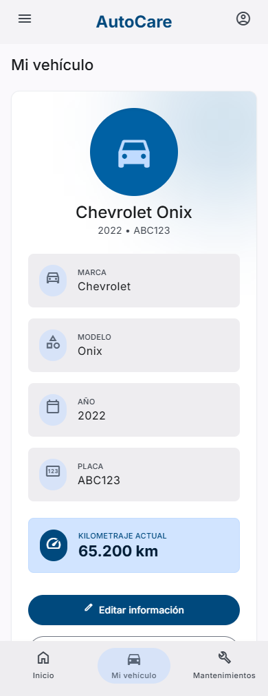
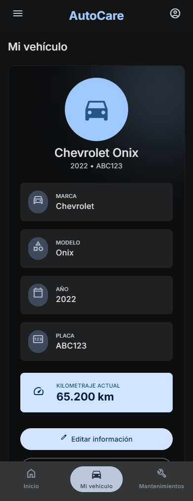
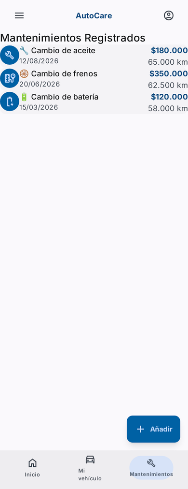
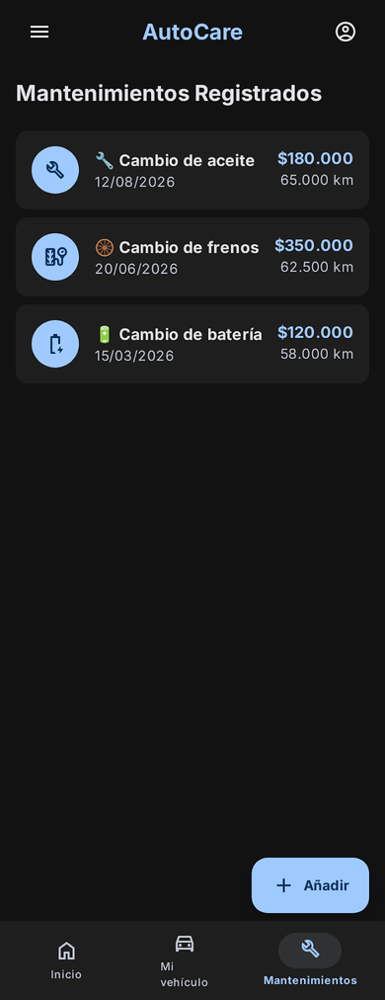

# Diseño de interfaz de usuario

AutoCare tiene cuatro pantallas, cada una disponible en modo claro y oscuro. Qué hace cada pantalla se describe en [funcionalidades.md](funcionalidades.md); aquí solo se muestra su diseño.

## Pantalla 1: Inicio de sesión

| Claro | Oscuro |
|:---:|:---:|
|  |  |

## Pantalla 2: Inicio / Dashboard

Funcionalidad: [Panel de inicio](funcionalidades.md#2-panel-de-inicio).

| Claro | Oscuro |
|:---:|:---:|
|  |  |

## Pantalla 3: Mi vehículo

Funcionalidad: [Gestión del vehículo](funcionalidades.md#1-gestión-del-vehículo).

| Claro | Oscuro |
|:---:|:---:|
|  |  |

## Pantalla 4: Mantenimientos registrados

Funcionalidades: [registro](funcionalidades.md#3-registro-de-mantenimiento), [historial](funcionalidades.md#4-historial-de-mantenimiento), [edición](funcionalidades.md#5-edición-de-mantenimientos) y [eliminación](funcionalidades.md#6-eliminación-de-mantenimientos).

| Claro | Oscuro |
|:---:|:---:|
|  |  |

## Referencias

- [Material Design: Foundations](https://m3.material.io/foundations)
- [Material Design: Style](https://m3.material.io/styles)
